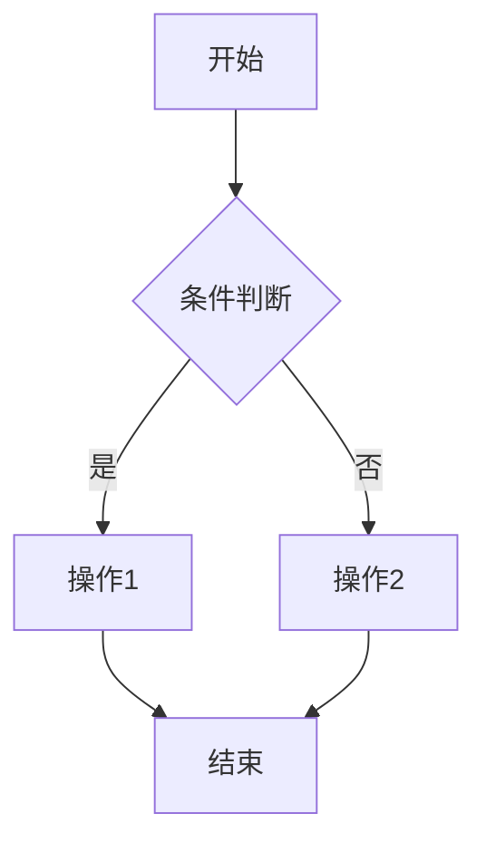

# PRD 模板

## 一、需求背景

描述当前面临的问题或机会。如果需求背景不清晰，主动询问用户。

---

## 二、需求目标

基于需求背景，写出本次项目的核心目标。

---

## 三、需求核心业务流程图

使用 Mermaid 语法绘制完整的业务流程图。



---

## 四、需求功能清单

按结构化表格表达（示例，不作为真实需求）：

| 终端 | 模块 | 功能 | 描述 |
|------|------|------|------|
| 业主小程序 | 首页 | -banner轮播 | 展示促销活动 Banner，支持点击跳转 |
| 业主小程序 | 我的 | -订单查询 | 支持按状态筛选订单列表 |
| 后端 | 订单服务 | -稽查规则引擎 | 根据规则匹配异常订单 |

---

## 五、需求功能详述

与第四部分需求功能清单保持一致，按模块分组，每个功能单独详细描述。

**每个功能的详细描述格式**（标题带序号，如 5.1、5.2）：

---

#### 5.x 终端——模块——功能名称

**原型描述**：
无原型则填"无"；有原型则写简洁描述，作为 AI 画原型的提示词。

原型描述遵循如下规范：
```
**原型描述编写规范**：
- 描述页面布局和关键元素
- 说明交互方式和状态
- 标注重要样式（颜色、位置）
- 示例："商品列表页顶部固定搜索栏，下方2列网格展示商品卡片，卡片含图片、名称、价格"
```

**用户故事**：
> 作为一个 [角色]，我想要 [操作]，以便于 [价值]。

**前置条件**：
- 用户需满足的状态或权限

**核心逻辑**：
- 计算规则、权限控制、数据流向

**边界条件与异常处理**：
- 边界条件：输入极限值、空值
- 异常处理：网络异常、数据冲突等处理方案

**技术难点分析**：
- [难点1]
- [难点2]

**验收标准 (Acceptance Criteria)**：
- 🎯 **成功场景**：输入 X，产出 Y
- ✔️ **校验场景**：输入错误格式，系统如何拦截
- ❌ **异常场景**：网络异常/超时，系统如何处理

**测试用例**（遵循 MECE 原则，每条用例语言精简，不超过 20 字）：
- [用例1]
- [用例2]
- [用例3]

---

## 六、非功能性需求

每条标准必须可测量、可验证，避免"快一点"、"稳定"等模糊表述。

### 6.1 性能

- **响应时间**：核心接口 P95 / P99 延迟
- **吞吐量**：QPS / TPS、并发用户数
- **容量预估**：数据量级（日增量、月存量）

### 6.2 可用性

- **SLA**：年度可用率
- **RTO / RPO**：故障恢复时间与数据丢失上限
- **降级策略**：核心链路兜底方案

### 6.3 安全

- **认证与权限**：登录方式、RBAC、敏感操作二次校验
- **数据加密**：传输 / 存储加密、密钥管理
- **合规与防护**：等保要求、防 SQL 注入 / XSS / CSRF / 越权

### 6.4 监控

- **核心指标**：业务指标 + 系统指标（错误率、QPS、慢请求）
- **告警规则**：告警分级、通知渠道、值班 SLA
- **日志与链路**：日志留存周期、Trace 接入

---

## 七、上线计划

### 7.1 灰度策略

- **批次与节奏**：分批比例与每批观察时长
- **灰度规则**：按用户 / 地域 / 渠道筛选灰度范围
- **放行标准**：每批推进的硬性指标
- **暂停条件**：触达阈值立即暂停的判定规则

### 7.2 回滚方案

- **触发条件**：明确阈值（错误率、关键告警等）
- **回滚步骤**：代码 / 配置 / 数据回退的顺序与负责人
- **回滚验证**：回滚后必须验证的核心场景
- **回滚时效**：从决策到执行完成的 SLA

